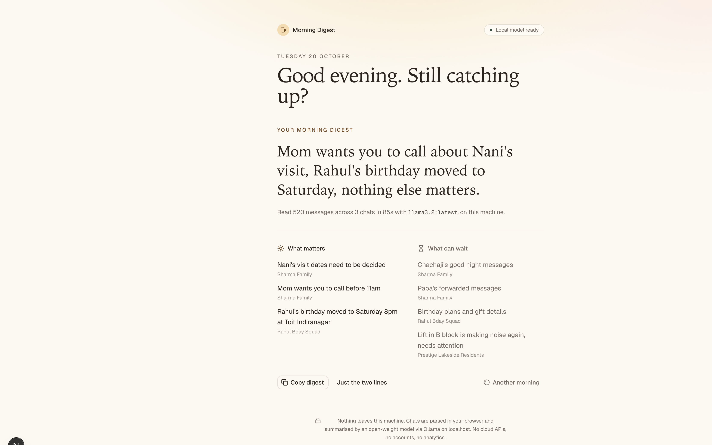

# SleepIn

I'm in a family group, a friends group and a society group, and every morning there are a few hundred unread messages waiting. Usually only two of them matter. So I made SleepIn: you give it last night's WhatsApp or Telegram export, a small open-weight model running on your own laptop reads everything, and you get something like:

> Rahul's birthday moved to Saturday, mom wants you to call, nothing else matters.



Everything runs on your machine. The chat file is parsed in the browser and the summary comes from Ollama on localhost. No cloud API, no login, no analytics (Next.js telemetry is switched off in the npm scripts too). That was the whole point. I'm not uploading my mom's messages anywhere.

Made for Week 3 of the Hacktoberfest Open-Source AI Challenge, "Slow and Steady" (International Sloth Day). The model does the catching up overnight, you stay in bed.

## Running it

You need Node 20+ and [Ollama](https://ollama.com).

```bash
brew install ollama            # or grab the installer from ollama.com
brew services start ollama     # or just run: ollama serve
ollama pull llama3.2           # ~2 GB
```

Then the app:

```bash
npm install
npm run dev
```

Open http://localhost:3000, click "Use sample chats" and then "Brew my digest". On my M-series MacBook, llama3.2 takes about a minute to a minute and a half for the ~520 sample messages. It's slow, that's kind of the theme.

Other models work too (qwen2.5, qwen3, gemma3...). The app picks up whatever you've pulled and shows a dropdown if you have more than one. If Ollama is on a different port or you want a different default, set these in `.env.local`:

```
OLLAMA_HOST=http://127.0.0.1:11434
OLLAMA_MODEL=llama3.2
```

### No Ollama?

It still works, just in demo mode (the pill at the top tells you). The sample chats get a pre-written digest so you can see what it's supposed to look like, and your own chats get a basic keyword-based summary. Install Ollama for the real thing.

## Exporting your chats

**WhatsApp on iPhone:** open the chat, tap the group name at the top, scroll down to Export Chat, choose Without Media. You'll get a zip, unzip it and use the `_chat.txt` inside.

**WhatsApp on Android:** open the chat, tap the three dots, More, Export chat, Without media. Send the `.txt` to your computer.

**Telegram:** this only works from Telegram Desktop, not the phone app. Open the chat, three dots, Export chat history, untick photos/videos, set the format to "Machine-readable JSON" and export. Use the `result.json`. A full account export (Settings, Advanced, Export Telegram data) also works and gets split into separate chats.

You can drop several files at once, or paste the text straight into the Paste tab.

## How it works

The first version sent all the chats to the model in one go. llama3.2 is a 3B model and it got confused: it mixed up which chat said what and quoted random memes as important. So now it goes one chat at a time and asks for a short headline, an importance score from 0 to 3, and lists of things that matter and things that can wait (as JSON, using Ollama's structured outputs). A few checks in code keep it honest:

- anything that names a person or place not actually in that chat gets dropped, since small models love making stuff up
- a chat only makes the headline if it mentions you or has something like a plan change or a request in it
- the final line is just the top headlines joined together, ending with "nothing else matters"

"Overnight" means the last 12 hours before the newest message in your export, not the current time, because exports are snapshots.

## Sample chats

The demo files are in `public/samples/`. They're generated by `scripts/generate-samples.mjs` (`npm run samples`), seeded so you get the same files every time:

- **Rahul Bday Squad** (WhatsApp, iPhone format): about 200 messages arguing Toit vs Arbor, plus the one where the birthday moves to Saturday
- **Sharma Family** (WhatsApp, Android format): good-morning forwards, Chachaji's lemon-water science, and Mom asking you to call
- **Lakeside Residents** (Telegram JSON): parking fights and a lost cat. Nothing you need.

The user in these chats is "Dev", so type that in the name box if you want it to know who "you" is.

## Built with

Next.js 16, TypeScript, Tailwind v4, shadcn/ui and Ollama.

## License

MIT, see [LICENSE](LICENSE).
